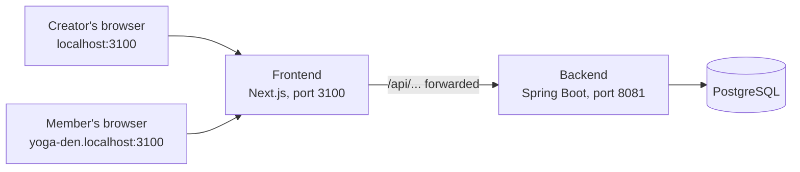
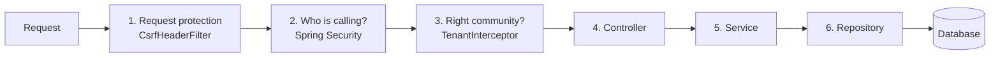
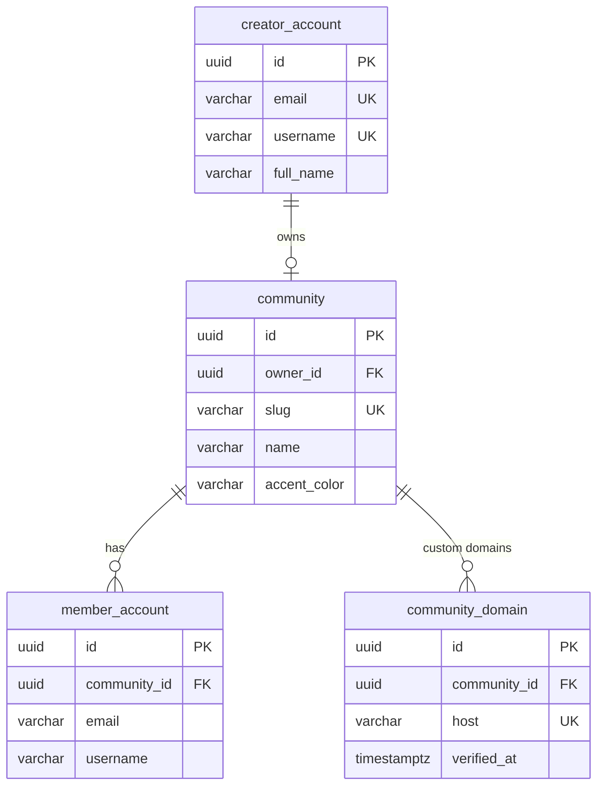
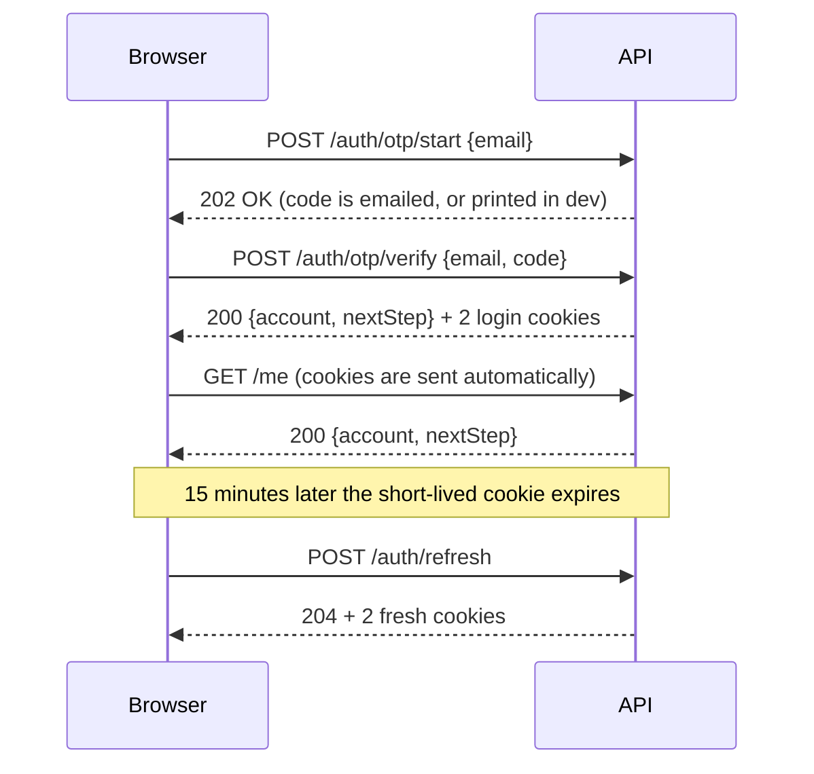

# How it's built

This page explains the project at four levels:

1. [Files](#1-file-level-where-things-live): where things live.
2. [Code](#2-code-level-how-a-request-is-handled): how a request is handled inside the backend and the frontend.
3. [Database](#3-database-level-tables-and-rules): the tables and the rules for changing them.
4. [Client and server](#4-client-server-level-how-the-browser-and-api-talk): how the browser and the API talk, including sign-in.

Each section stands on its own. To run the app and sign in while you develop, read
[DEVELOPER_GUIDE.md](DEVELOPER_GUIDE.md). For every endpoint, read [API.md](API.md).

## The idea in 30 seconds

- A **creator** signs up on the platform and gets a **community**: their own branded space.
- **Members** join that community on the community's own address (`yoga-den.yourdomain.com`,
  and later the creator's own domain). They never see the platform's name.
- So one app shows different sites depending on **which address you open**.



The browser only ever talks to the frontend. The frontend forwards every `/api/...` call to the
backend, and only the backend touches the database.

---

## 1. File level: where things live

```
untitled_base/
├── backend/            Java API (Spring Boot). Owns all data and rules.
├── frontend/           Website (Next.js). Creator studio + every community's site.
├── docs/               These guides.
├── scripts/            Database setup without Docker.
├── docker-compose.yml  Postgres + Mailpit for local development.
└── .github/workflows/  CI: runs tests and checks on every push.
```

### Backend: `backend/src/main/java/com/projectuntitled/`

The code is grouped **by feature**, so each friend can own a folder:

```
auth/        Sign-in codes, login tokens, cookies, request protection
creator/     Creator accounts, onboarding, studio dashboard
community/   Communities, their web address (slug), branding, custom domains
member/      Member accounts (always inside one community)
web/         Checks that a member only reaches their own community
common/      Shared pieces: base entity, error handling, small helpers
config/      Settings, security rules, Swagger, clock
```

Inside a feature folder, each file type has one job:

| File | Job | Example |
| ---- | --- | ------- |
| `XxxController` | Receives the HTTP request, returns JSON. No business rules. | `CreatorController` |
| `XxxService` | Business rules and database transactions. | `CreatorService` |
| `XxxRepository` | Reads and writes one table. | `CreatorAccountRepository` |
| `Xxx` (entity) | One table row as a Java object. | `CreatorAccount` |
| `XxxDto`, `XxxRequest`, `XxxResponse` | The JSON shapes going in and out. | `CreatorDto` |

Other backend files:

| Path | What it is |
| ---- | ---------- |
| `src/main/resources/application.yml` | Shared settings |
| `src/main/resources/application-dev.yml` | Settings for your machine (used by default) |
| `src/main/resources/application-prod.yml` | Production settings; every secret comes from environment variables |
| `src/main/resources/db/migration/` | Database changes, one SQL file per change |
| `src/test/` | Tests. They run against a real test database |

### Frontend: `frontend/src/`

```
proxy.ts          Looks at the address and picks: studio, or which community's site
app/(studio)/     Creator studio pages: /login, /onboarding/*, /dashboard/*
app/site/[slug]/  Community site pages: /, /login, /onboarding, /home
components/
  ui/             Buttons, inputs, avatar, icons
  auth/           Sign-in screens shared by creators and members
  studio/         Studio screens (dashboard, members, branding)
  site/           Community site screens and branding
lib/api/          Functions that call the backend, plus TypeScript types for its JSON
lib/              Small helpers (address parsing, formatting, routes, config)
hooks/            useGatedSession: sends you to login or onboarding when needed
app/globals.css   Colours, fonts and Tailwind theme
public/           Images and icons
```

### Where do I put...?

| I'm adding... | Put it in |
| ------------- | --------- |
| A new backend feature (e.g. courses) | A new folder `backend/.../course/` with controller, service, repository, entity, DTOs |
| A new table or column | A new file `backend/src/main/resources/db/migration/V2__add_courses.sql` |
| A new setting | `config/AppProperties.java` and `application.yml` |
| A new studio page | `frontend/src/app/(studio)/dashboard/<name>/page.tsx` + a screen in `components/studio/` |
| A new community-site page | `frontend/src/app/site/[slug]/<name>/page.tsx` + a screen in `components/site/` |
| A new API call in the frontend | `frontend/src/lib/api/creator.ts` or `member.ts`, and its types in `types.ts` |

The step-by-step version is in [CONTRIBUTING.md](../CONTRIBUTING.md).

---

## 2. Code level: how a request is handled

### Backend: the journey of one request

Take `GET /api/v1/creator/me` ("who am I?"). It passes through these steps in order:



1. **Request protection** (`auth/web/CsrfHeaderFilter`). Every POST, PUT, PATCH or DELETE must carry
   the header `X-Requested-With`. This stops other websites from submitting forms to our API.
2. **Who is calling?** (`config/SecurityConfig`). Spring Security reads the login token from the
   cookie, checks it's genuine and not expired, and checks the role. Creator routes need a
   creator; member routes need a member.
3. **Right community?** (`web/TenantInterceptor`, member routes only). It loads the community from
   the address and rejects a member who belongs to a different community.
4. **Controller**. It only reads input and returns output. `@CurrentCreator` hands it the signed-in
   creator, so no controller parses tokens itself.
5. **Service**. The business rules live here, such as "usernames must be unique" or "one community
   per creator".
6. **Repository**. It reads and writes the database.

This is the real controller method:

```java
@GetMapping("/me")
public CreatorMeResponse me(@CurrentCreator CreatorAccount creator) {
    Community community = communityService.findByOwner(creator.getId()).orElse(null);
    return new CreatorMeResponse(
            CreatorDto.from(creator),
            community == null ? null : communityService.toDto(community),
            CreatorOnboarding.nextStep(creator, community));
}
```

**When something goes wrong**, code throws an `ApiException` with a short code, for example
`ApiException.notFound("COMMUNITY_NOT_FOUND", "This community doesn't exist.")`.
`common/error/GlobalExceptionHandler` turns it into a JSON error (see section 4).

**Rules the team follows:**

- Controllers stay thin; services hold the logic.
- Entities point to each other by id (`communityId`), not with JPA relationships. It's simpler
  and avoids hidden database queries.
- Services get the current time from an injected `Clock`, never `Instant.now()`, so tests can control time.
- Settings live in `AppProperties`. Secrets come from environment variables in production.

### Frontend: from address to screen

Take a member opening http://morning-yoga-den.localhost:3100/home:

1. **`proxy.ts` looks at the address.** `morning-yoga-den.localhost` is a community, so it
   quietly serves `app/site/morning-yoga-den/home` (an internal rewrite, the visible address
   doesn't change). Plain `localhost:3100` gets the studio. Unknown communities get a 404.
2. **The layout loads the branding.** `app/site/[slug]/layout.tsx` fetches the community's name,
   logo and colour on the server (cached for up to 5 seconds) and shares them with every page.
3. **The page is tiny.** `page.tsx` just renders a screen from `components/site/`.
4. **The screen checks the login.** `useGatedSession` asks the backend `/me`. Depending on the
   answer it shows the screen, or sends the person to `/login` or `/onboarding`.
5. **The screen calls the backend** through `lib/api` (`creatorApi` or `memberApi(slug)`), which
   returns typed data.

**Styling:** use Tailwind classes with the theme colours in `app/globals.css` (`bg-ink`,
`text-muted`, `border-line`). Community sites use `bg-accent` / `text-accent`, which become the
creator's brand colour.

**Next.js 16 is newer than most tutorials.** A few rules in this project come from that:

- Studio dashboard pages export `instant = false`, because the login is checked in the browser.
- Every community-site page renders `<RequestTimeMarker />`, because those pages depend on the address.
- The Next.js docs for this exact version are in `frontend/node_modules/next/dist/docs`.

---

## 3. Database level: tables and rules

### The tables



| Table | One row is... | Key rules |
| ----- | ------------- | --------- |
| `creator_account` | A creator | Email and username are unique across the platform |
| `community` | A creator's branded space | `slug` (the web address) is unique. One community per creator for now |
| `member_account` | A member **of one community** | Email and username are unique **within** that community |
| `community_domain` | A custom domain for a community | Only verified domains work. No screen for this yet |
| `otp_challenge` | A sign-in code that was sent | Stores a fingerprint (HMAC) of the code, never the code itself |
| `refresh_token` | A login session (one per device) | Stores a fingerprint (SHA-256) of the token, never the token itself |

**Why members have one account per community:** if Priya joins two creators' communities with the
same email, she gets two separate accounts. This is what makes each community feel like its own
product. No site ever says "you already have an account on Platform X".

### Rules for changing the database

- **Flyway owns the schema.** Each change is a new SQL file in
  `backend/src/main/resources/db/migration/`: `V2__add_courses.sql`, then `V3__...`, and so on.
  It runs automatically when the backend starts.
- **Never edit a migration that's already merged.** Other people's databases already ran it.
  Add a new file instead.
- Hibernate only **checks** that the Java entities match the tables. It never changes the tables.
- Conventions: `uuid` ids, `timestamptz` for times (stored in UTC), and every table has
  `created_at` and `updated_at`. Java entities extend `BaseEntity` to get these.
- Every query on member data must filter by `community_id`.

### Look at the data

```bash
psql -h localhost -U project_untitled project_untitled      # password: project_untitled
```

```sql
SELECT email, username FROM creator_account;
SELECT slug, name, accent_color FROM community;
SELECT c.slug, m.email FROM member_account m JOIN community c ON c.id = m.community_id;
```

---

## 4. Client-server level: how the browser and API talk

### The browser only talks to its own address

The browser calls `/api/v1/...` on whatever address it's on (`localhost:3100` or
`yoga-den.localhost:3100`). Next.js forwards those calls to the backend (see `next.config.ts`).
This has two benefits:

- **Login cookies belong to each address.** Every community site keeps its own separate login,
  with no extra code.
- **No CORS setup is needed**, because the browser never calls another domain.

### The API's three areas

| Path | Who can call it | Example |
| ---- | --------------- | ------- |
| `/api/v1/public/**` | Anyone | Community name, logo and colour for its site |
| `/api/v1/creator/**` | A signed-in creator | Dashboard, members list, branding |
| `/api/v1/c/{slug}/**` | A signed-in member **of that community** | Member profile |

Anything else is blocked by default. Each area has its own `/auth/...` endpoints for signing in.

### Sign-in, step by step

There are no passwords. Sign-up and sign-in are the same flow.



- If the email is new, `verify` creates the account. `newAccount` says whether that happened.
- **`nextStep`** tells the frontend which screen comes next: `PROFILE` (add name and username),
  `COMMUNITY` (creators only: name your community) or `DONE` (go to the dashboard or home).
  It's worked out from the data each time, not stored.

### The two login cookies

| Cookie | What it holds | Lasts | Sent to |
| ------ | ------------- | ----- | ------- |
| Access token | A signed JWT saying who you are, your role, and (for members) your community | 15 minutes | Your area's API calls |
| Refresh token | A random key, used only to get new cookies | 30 days | Only your area's `/auth` endpoints |

- Creators have `creator_access_token` and `creator_refresh_token`. Members have
  `member_access_token` and `member_refresh_token`, limited to their community's path.
- Both are **httpOnly**, so page JavaScript can't read them. That protects them if a page is ever hacked.
- When the access token expires, the frontend client (`lib/api/client.ts`) calls `/auth/refresh`
  once, then retries the request. The user never notices.
- **Every refresh swaps in a brand-new refresh token.** If an old one is reused more than 30
  seconds later, someone may have stolen it, so the API signs that account out everywhere.
- Scripts and tools can send `Authorization: Bearer <token>` instead of cookies.

### Every request

- The frontend adds `X-Requested-With: fetch` to every call (required on writes, see section 2).
- JSON in, JSON out.
- Lists are paged: `?page=0&size=20` returns `{ items, page, size, totalItems, totalPages }`.

### Errors

Every error has the same shape, with a stable `code` the frontend can check:

```json
{ "status": 400, "code": "OTP_INVALID", "detail": "That code isn't right.", "attemptsRemaining": 3 }
```

The frontend shows `detail` to the user and uses `code` to decide what to do. The full list of
codes is in [API.md](API.md#error-codes-youll-see).

### How communities are kept apart

Four separate locks stop one community from seeing another's data:

1. **Separate accounts.** A member account belongs to exactly one community.
2. **Separate logins.** Each address has its own cookies, and a member's token names their community.
3. **A check on every request.** `TenantInterceptor` rejects a member token from another community
   (`403 WRONG_COMMUNITY`).
4. **Filtered queries.** Every query on member data includes `community_id`.

### White-label details

- Sign-in emails for members come **from the community's name** ("Morning Yoga Den"), not the platform.
- Community sites use the community's name, logo, colour and browser-tab title.
- The platform's own name only appears in the creator studio.

---

## Known limits of this first version

These are tracked in [ROADMAP.md](ROADMAP.md):

- Code limits are per email only; there's no per-IP limit yet.
- Old codes and expired sessions aren't cleaned up automatically yet.
- Branding changes take up to 5 seconds to show on the community site.
- Logo and avatar upload isn't built; the logo is a web link for now.
